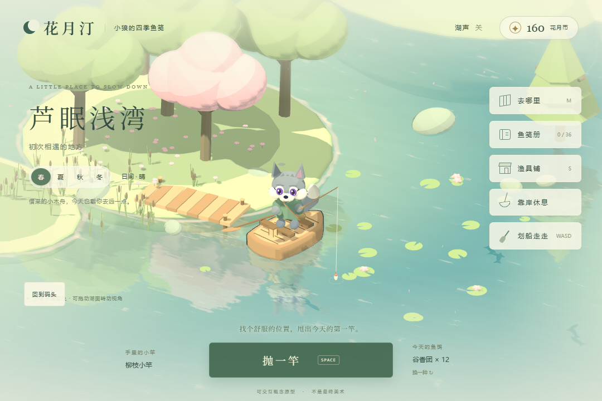

# 花月汀 · 小狼的四季鱼笺

v0.2 今日版已补齐划船、Blender 小狼模型与回归验收，详见 [2026-11-17 交付记录](verification/HANDOFF_2026-11-17.md)。

一份原创治愈系钓鱼游戏的可交互概念原型。小灰狼是女孩子，灰白毛、紫瞳、苔绿斗篷，划着小木舟，去把四季收进鱼笺册。

## 现在就玩

在本目录运行 `npm start`，然后用浏览器打开 `http://127.0.0.1:4173`。也可以双击「启动花月汀.cmd」。本地服务只监听自己的电脑，Three.js 已随项目提供，不依赖 CDN。

点击「抛一竿」等待浮漂，鱼上钩时再点击一下。随后按住按钮收线，松开降张力，让小竖线保持在绿色区间；空格键也可操作。收到鱼后，可以记下它并放归，或者带去交换花月币。两种选择都记图鉴。

左上切换四季，点时段切换日间／黄昏／夜晚；右侧打开地图、鱼笺册、渔具铺，或靠岸／乘船。拖动湖面轻微转动镜头，滚轮调整远近。右上「湖声」手动开启环境音。M 打开地图，B 打开图鉴，S 打开商店。

在芦眠浅湾打开地图点「落樱溪 · 划船」，按屏幕上方的目的地方向提示划船，去程按 → / D（手机按右桨）抵达樱树码头。停泊后可钓当地鱼；按 ← / A 沿同一条水路返回。其余水域沿用地图直达。

乘船时点击「划船走走」，用 WASD／方向键或屏幕上的四个方向按钮划行；点「停桨垂钓」停在喜欢的水边。也可以直接抛竿，船会先自动停下。「回到码头」随时提供回岸救援。打开地图、册子、渔具铺时暂停航行，输入文字时不会触发移动。

## 这份原型实际包含什么

真实 Three.js WebGL 三维场景、分段卡通着色和实际加载的 Blender 小狼 GLB；四季与三种时段；六处可切换的水域主题；36 条原创鱼数据与 3／4／5／6 星稀有度；按地点、季节、时段、乘船条件筛选的来鱼池；等鱼、咬钩、张力收线与捕获结算；鱼饵购买与鱼竿装备；小舟自由划行、基础水岸边界、停桨与回码头；图鉴、筛选、个人注记、成就印章；浏览器本地存档；手机窄屏界面。

六个水域在原型中使用同一套场景结构切换植被和环境主题，不是六张完成的独立关卡。小狼仍是可编辑粗模，源文件在 assets/wolf-girl.blend，游戏资产在 assets/wolf-girl.glb，棚拍图在 assets/wolf-girl-preview.png；尚未制作生产级蒙皮与面部绑定。地图是 HTML/CSS 的可交互地理示意，鱼笺插画是 Canvas 栅格绘制；没有 SVG。湖面、角色与船均为实际三维网格。

## 正式版的方向

见「花月汀-游戏设计书.md」和「鱼谱与经济.csv」。完整开发建议为 Blender 制作角色／骨骼／环境，Unity URP 承载正式游戏并验证 NiloToonURP 的适配；当前 Three.js 原型用于确认画面构图与玩法。NiloToonURP 属于 Unity URP，不能直接当作 Godot 或 Three.js 的材质插件。没有安装、购买或声称已经集成 NiloToon。

## 数据与隐私

花月币为游戏内虚构货币，没有真实支付、兑换、联网账号、遥测或广告。存档保存在当前浏览器当前地址的 localStorage；更换浏览器／端口不会自动带走存档，清除站点数据会删除进度。

## 检查

`npm run check` 检查 JS 语法、鱼种数量、所有水域／四季／时段鱼池、每条鱼的可达性、船只限制、六星保底与航行的移动／停泊／暂停／边界／救援，以及岸线、鱼群避船和尾迹消散，并重新输出 CSV。

`uv run --with playwright python tools/verify.py` 通过独立无头 Chrome 实际操作 UI；浏览器截图和验证结果写入 verification。该脚本读取测试用的全新浏览器存档，不修改游玩浏览器的存档。

`uv run --with playwright python tools/verify-sailing.py` 实际验证键盘划船、停桨、菜单暂停、救援回码头和手机方向按钮。`uv run --with playwright python tools/verify-economy.py` 用明示的测试存档验证买竿、换竿、买船和交换鱼。运行 UI 检查前保持本地服务启动，并安装 Chrome；不是通过测试接口凭空添加鱼。

Three.js 0.170.0 使用 MIT 许可，原文保留于 vendor/THREE-LICENSE.txt。本项目角色、世界设定与鱼种文案原创；参考游戏只提炼玩法设计原则，未引入其模型、贴图、音乐或商标资产。

## 名字

「花月汀」是暂定名，以后再想。

## 版权

版权归绮思（Qisi Riki）所有，保留所有权利。

- 禁止商业使用
- 禁止商业二次修改、改编与再发布
- 未经作者授权，不得将本作品或其任何部分用于商业用途

详见 [LICENSE](./LICENSE)。
